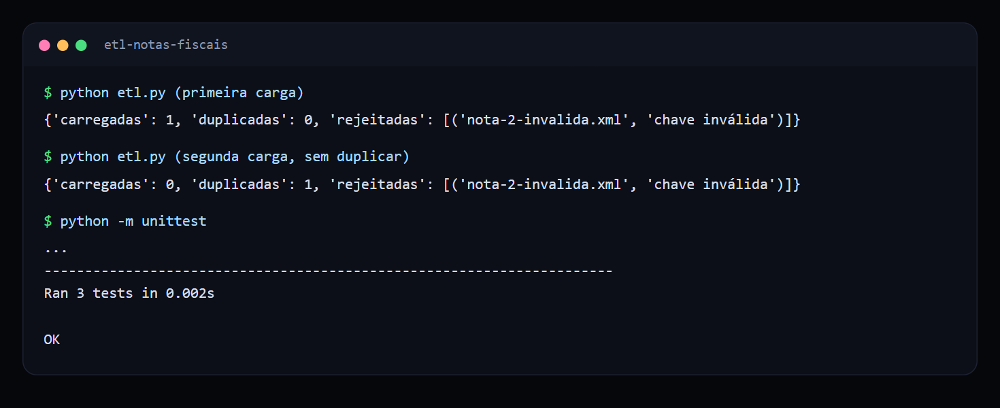
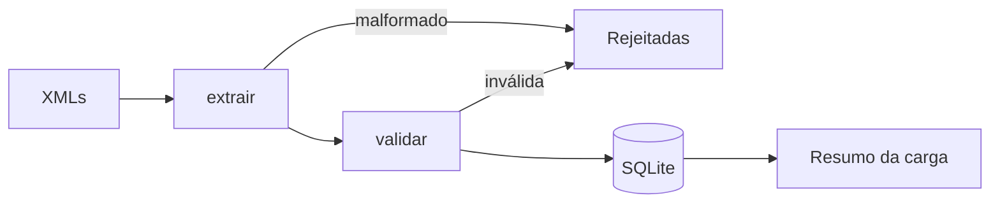

# ETL de notas fiscais

Pipeline que lê arquivos XML de notas, valida os dados e carrega tudo em um banco SQLite sem duplicar registros.

 

## Veja funcionando



*Primeira carga, segunda carga sem duplicar e nota inválida rejeitada com o motivo.*

## O problema

Digitar notas fiscais à mão é lento e gera erro. Automatizar a leitura só resolve de verdade se o processo aguentar arquivo ruim, nota repetida e reprocessamento sem contaminar a base.

## O que ele faz

- **Extrai** chave, emitente, data e total de cada XML.
- **Valida** chave de 44 dígitos, emitente preenchido e total positivo.
- **Carrega** as notas válidas no SQLite, usando a chave como identificador.
- **Resume** quantas notas entraram, quantas eram repetidas e quais foram rejeitadas, com o motivo.

## Como funciona



> Os XMLs de exemplo usam um formato simplificado. O layout oficial da NF-e tem mais campos e namespaces.

## Decisões técnicas

| Decisão | Motivo |
| --- | --- |
| Chave como `PRIMARY KEY` com `INSERT OR IGNORE` | A carga pode rodar de novo sem duplicar. |
| Arquivo ruim não interrompe o lote | Uma nota com problema não bloqueia as outras. |
| Rejeição com motivo | A equipe sabe exatamente o que corrigir. |
| Parâmetros nomeados no SQL | Evita injeção de SQL a partir do conteúdo do XML. |

## Como rodar

```bash
python etl.py
python etl.py caminho/da/pasta
python -m unittest
```

## Próximos passos

- Ler o layout completo da NF-e.
- Validar o dígito verificador da chave.
- Baixar as notas automaticamente de uma caixa de e-mail.

## Sobre este projeto

Projeto de demonstração, com dados e empresas fictícios, criado para mostrar a abordagem técnica de forma simples.

## Autor

**Luiz Renato Carvalho**, Engenheiro de Software e IA · [luizrenato.dev](https://www.luizrenato.dev) · [LinkedIn](https://linkedin.com/in/luizrenatodc)
